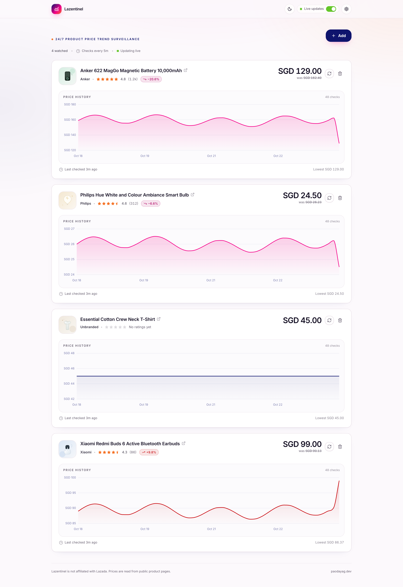
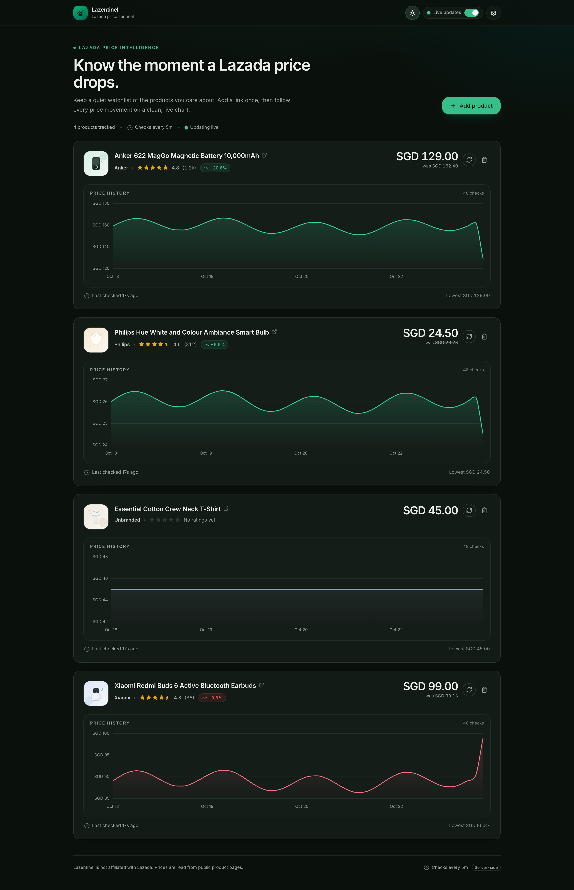

# Lazentinel

Website: https://lazentinel.paodayag.dev

**Lazada + Sentinel.** Lazentinel is a self-hosted Lazada price watchlist. Paste a product URL once and the server checks it in the background, records every price observation in SQLite, and serves a live, animated dashboard that shows the biggest price drops first.



## Installation

### Docker

```yaml
services:
  app:
    image: wisdomsky/lazentinel:latest
    container_name: lazentinel
    restart: unless-stopped
    init: true
    ports:
      - "3008:3008"
    environment:
      NODE_ENV: production
      PORT: 3008
      TRACKING_INTERVAL_MINUTES: 60
      DATABASE_PATH: /app/data/lazentinel.db
      AUTH_DATABASE_PATH: /app/data/lazentinel-auth.db
      CLIENT_DIST: /app/client/dist
      ENABLE_MULTIUSER: true # Optional: Enables multiple users. Allows different users to create their own dedicated accounts.
      PROXY_ENABLED: true
      PROXY_SCHEME: http

      # Uncomment this environment variable if you are serving Lazentinel over https
      # COOKIE_SECURE: true

      # Optional: If you have a Cloak Browser Subscription, you can enter your license key to use it
      # CLOAKBROWSER_LICENSE_KEY:

      # Optional: If you provide a 2Captcha API Key, it will use the Browser API as a fallback if the default stealth browser + proxies all ultimately failed
      # TWOCAPTCHA_API_KEY:
    volumes:
      - /DATA/AppData/lazentinel:/app/data
```


## Features

- Add any Lazada product by URL (Singapore, Malaysia, Thailand, Philippines, Indonesia and Vietnam).
- Tracks the **displayed sale price** — not the struck-through original/list price — plus the live rating and review count.
- Background tracking on an interval configured with `TRACKING_INTERVAL_MINUTES` (default **5 minutes**, minimum 5 seconds).
- Real-time countdown to the next check, with a checking indicator while a price check is running.
- SQLite persistence — products and full price history survive restarts.
- Product cards with title, brand, rendered stars, review count, current price, drop badge and a chronological price chart.
- Live reordering by price drop percentage, animated with a FLIP transition so cards can be followed while they move.
- A **Live** switch in the header that pauses all browser updates (charts and card order) while the server keeps tracking.
- Add, delete and "check now" actions, with clear loading, warning and error states.
- Optional multi-user mode with accounts, a login screen, and private per-account watchlists.
- Light and dark themes with a system-aware initial preference and a header toggle.
- Single-page app served by the same Express server; multi-stage Docker image with a persistent data volume.

### Themes

Lazentinel follows your operating system's light/dark preference on first visit and
remembers the last choice. Use the sun/moon button in the header to switch themes. Both
themes use Lazada's navy, pink, red and orange brand palette.

<details>
<summary>Dark mode preview</summary>



</details>

## Disclaimer

Lazentinel is not affiliated with or endorsed by Lazada. It is intended for personal price tracking. Respect the site's terms of service and avoid aggressive polling intervals.
