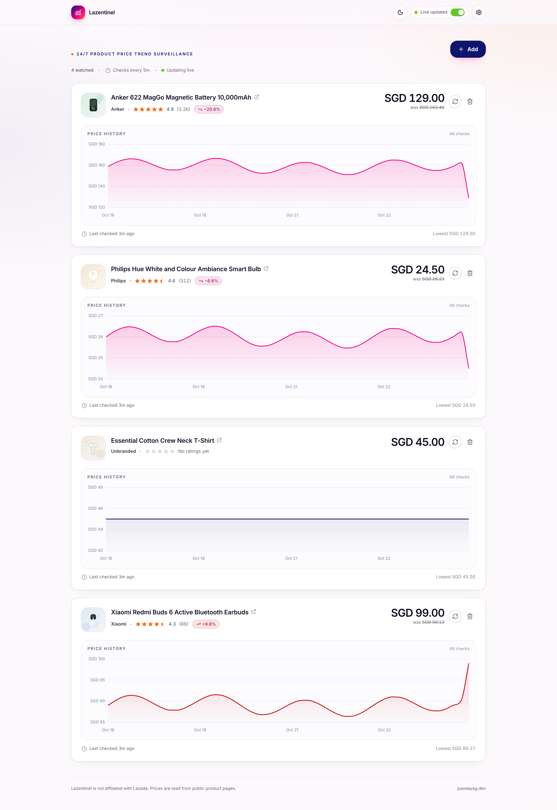
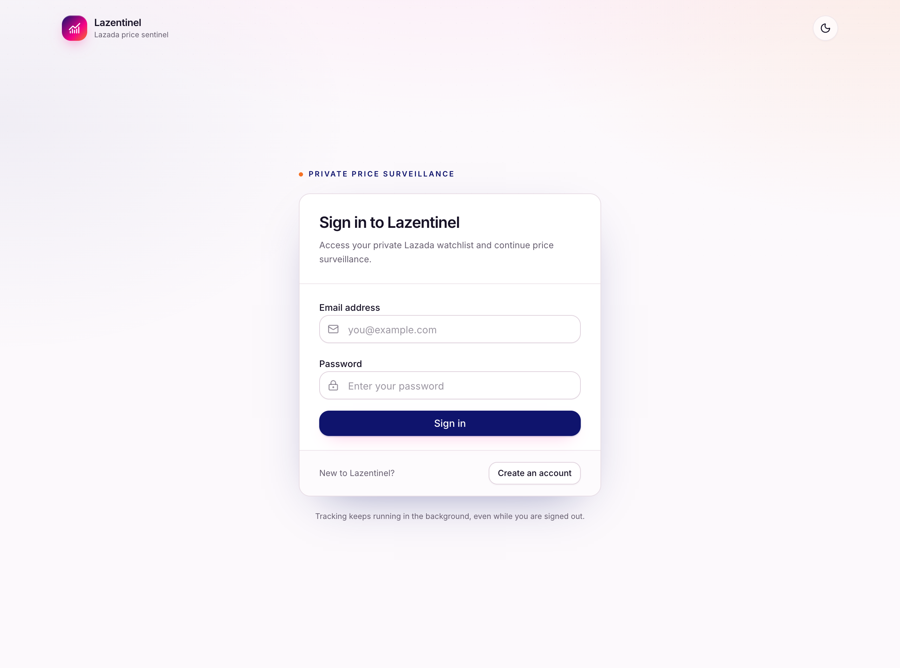
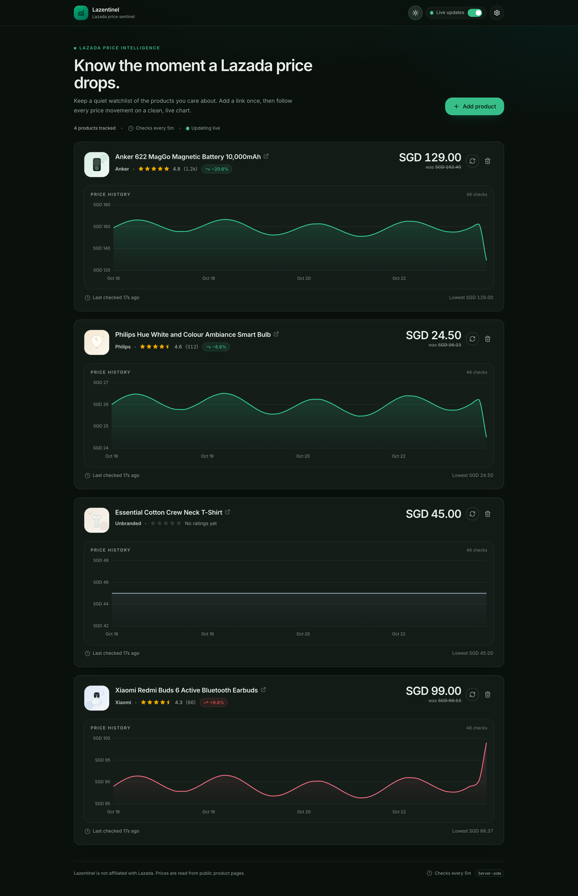
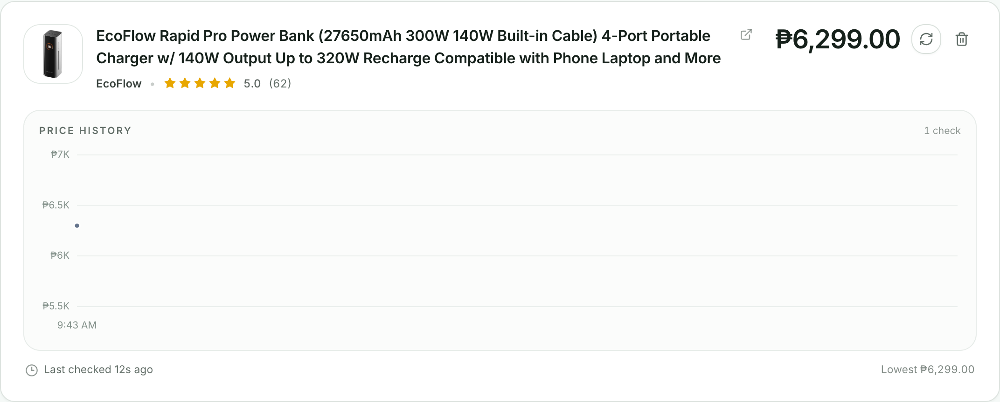

# Lazentinel

**Lazada + Sentinel.** Lazentinel is a self-hosted Lazada price watchlist. Paste a product URL once and the server checks it in the background, records every price observation in SQLite, and serves a live, animated dashboard that shows the biggest price drops first.



> The screenshot is generated from the included demo data.

## Features

- Add any Lazada product by URL (Singapore, Malaysia, Thailand, Philippines, Indonesia and Vietnam).
- Tracks the **displayed sale price** — not the struck-through original/list price — plus the live rating and review count.
- Background tracking on an interval you choose from Settings (default **300 seconds**, minimum 5).
- SQLite persistence — products and full price history survive restarts.
- Product cards with title, brand, rendered stars, review count, current price, drop badge and a chronological price chart.
- Live reordering by price drop percentage, animated with a FLIP transition so cards can be followed while they move.
- A **Live** switch next to Settings that pauses all browser updates (charts and card order) while the server keeps tracking.
- Add, delete and "check now" actions, with clear loading, warning and error states.
- Optional multi-user mode with accounts, a login screen, and private per-account watchlists.
- Light and dark themes with a system-aware initial preference and a header toggle.
- Single-page app served by the same Express server; multi-stage Docker image with a persistent data volume.

## Multi-user mode

Multi-user mode is opt-in and preserved exactly when disabled.

```bash
ENABLE_MULTIUSER=true npm run dev
# or
ENABLE_MULTIUSER=true docker compose up --build -d
```

Only the exact value `true` enables it. When enabled:



- The first screen is sign-in. New users can create an account with email, password
  and password confirmation, then sign in.
- Each account only sees and manages its own products. Two accounts may watch the
  same Lazada URL independently.
- Background tracking continues for every stored product whether its owner is
  signed in or not.
- Clicking **Sign out** returns to the login screen.
- The tracking interval setting remains global for the installation and is read-only
  while multi-user mode is enabled.

Accounts and sessions are stored in a **separate SQLite database**
(`./data/lazentinel-auth.db`, configurable via `AUTH_DATABASE_PATH`), while products
remain in the product database. As required, **passwords are stored in plaintext**
in the auth database. This is not safe for an untrusted or public deployment: protect
the data volume, use HTTPS (`COOKIE_SECURE=true`), and consider replacing the
plaintext scheme before exposing Lazentinel to the internet.

Products created before enabling multi-user mode have no owner and are not shown to
logged-in users, but they continue to be tracked. Delete and re-add them while signed
in to keep them in a private watchlist. Cookies are HTTP-only, SameSite=Lax, and
expire after 30 days.

## How "price drop" is calculated

For each product, the backend finds the latest price and the most recent **earlier price that differs from it** (the previous price level). The drop is:

```text
dropPercent = (previousPrice - currentPrice) / previousPrice * 100
```

Positive means the price fell; negative means it rose. Products are sorted by `dropPercent` descending, then by id. Using the previous *different* price keeps a drop visible while the price stays flat, instead of resetting to zero on every check.

## Tech stack

| Layer     | Choice                                              |
| --------- | --------------------------------------------------- |
| Backend   | Node.js 24, Express 5, TypeScript, better-sqlite3   |
| Pricing   | CloakBrowser stealth Chromium (Playwright API)      |
| Frontend  | Vue 3, Vite 8, TypeScript, TailwindCSS 4, SCSS      |
| UI        | Shadcn-style components built on Reka UI, Chart.js  |
| Database  | SQLite (WAL mode)                                   |
| Packaging | Multi-stage Dockerfile + Docker Compose             |

## Quick start (development)

Requirements: Node.js 22.12+, npm, and CloakBrowser's stealth Chromium (downloaded in one command).

```bash
npm install
npm --prefix client install
npm run setup:browser   # CloakBrowser's stealth Chromium (~200 MB, once)
npm run dev
```

`setup:browser` is optional: the first scrape downloads the same binary if it is
missing. Docker users can skip it — the image bundles CloakBrowser and its browser.

- Frontend: <http://localhost:5173>
- API: <http://localhost:3001>

Vite proxies `/api` to the Express server. The SQLite file is created at `./data/lazentinel.db`.

### Optional demo data

An empty dashboard is hard to evaluate. The included seed script adds four realistic demo products with several days of price history:

```bash
npm run seed:demo
```

The script refuses to overwrite existing products unless you pass `--force`. With `--force` it only replaces the four known demo URLs, never your other products. Demo entries use placeholder product URLs for a stable screenshot, so their later background checks will fail; use real Lazada URLs for actual tracking.

### Themes

Lazentinel follows your operating system's light/dark preference on first visit and
remembers the last choice. Use the sun/moon button in the header to switch themes. Both
themes use Lazada's navy, pink, red and orange brand palette.

<details>
<summary>Dark mode preview</summary>



</details>

## Run with Docker

```bash
npm run docker
```

This builds the image and starts it in the background via Docker Compose. Stop it with:

```bash
npm run docker:down
```

The equivalent raw commands are `docker compose up --build -d` and `docker compose down`. Open <http://localhost:3008>. Data is stored in the `.lazentinel-data` directory bind-mounted into the container. The image includes CloakBrowser's stealth Chromium so Lazada's client-side sale price can be read; expect a larger image and additional build time. To use a different host port:

```bash
APP_PORT=8080 npm run docker
```

The published multi-architecture image is available at
[`wisdomsky/lazentinel`](https://hub.docker.com/r/wisdomsky/lazentinel):

```bash
docker pull wisdomsky/lazentinel:latest
docker run -d --name lazentinel \
  -p 3000:3000 \
  -v lazentinel-data:/app/data \
  --restart unless-stopped \
  wisdomsky/lazentinel:latest
```

To build a local image instead:

```bash
docker build -t wisdomsky/lazentinel:latest .
```

## Production build without Docker

```bash
npm install
npm --prefix client install
npm run build
PORT=3000 DATABASE_PATH=./data/lazentinel.db npm start
```

The Express server serves both the API and the built SPA from `client/dist`.

## Publishing to Docker Hub

The GitHub Actions workflow at
[`.github/workflows/docker-publish.yml`](.github/workflows/docker-publish.yml)
builds and publishes `wisdomsky/lazentinel` for `linux/amd64` and `linux/arm64`
on every push to `main`/`master` and on `v*.*.*` tags. It also supports manual
`workflow_dispatch` runs. The Vitest suite and full typecheck run before any
image is pushed.

Configure these repository secrets:

| Secret | Required | Description |
| ------ | -------- | ----------- |
| `DOCKERHUB_TOKEN` | yes | Docker Hub access token with Read & Write permission |
| `DOCKERHUB_USERNAME` | no | Defaults to `wisdomsky` |

Images are tagged with `latest` on the default branch, `sha-<shortsha>` for each
build, and semantic tags for version tags such as `v1.2.3`.

## Configuration

| Variable         | Default               | Description                                  |
| ---------------- | --------------------- | -------------------------------------------- |
| `PORT`           | `3000`                | HTTP port                                    |
| `DEFAULT_TRACKING_INTERVAL_MINUTES` | `5` | Interval in minutes; when set, applied on startup and overrides the saved interval |
| `DATABASE_PATH`  | `./data/lazentinel.db` | SQLite file (parent directory is created)   |
| `CLIENT_DIST`    | `./client/dist`       | Directory of the built Vue app               |
| `ENABLE_MULTIUSER` | `false`             | Enable accounts and private watchlists (`true` only) |
| `AUTH_DATABASE_PATH` | `./data/lazentinel-auth.db` | Separate account/session database |
| `COOKIE_SECURE`  | `false`               | Set `true` when served over HTTPS            |
| `CLOAKBROWSER_BINARY_PATH` | auto       | Optional path to a local Chromium binary (skips the stealth download) |
| `CLOAKBROWSER_CACHE_DIR` | `~/.cloakbrowser` | Where CloakBrowser caches its stealth Chromium |
| `CLOAKBROWSER_LICENSE_KEY` | —        | Optional CloakBrowser Pro key for the newest binary |
| `CLOAKBROWSER_PROXY` | —            | Optional single static proxy; disables the rotating pool |
| `PROXY_ENABLED`  | `true`                | Rotate Lazada requests through `server/proxy/proxy_locations.json` |
| `PROXY_SCHEME`   | `http`                | Proxy protocol for the rotating pool: `http` or `socks5` |
| `TWOCAPTCHA_API_KEY` | —                 | Optional 2Captcha key for the Browser API fallback |

Copy `.env.example` to `.env` for local overrides (already-set environment variables win). `CHROMIUM_EXECUTABLE` remains accepted as a legacy alias for `CLOAKBROWSER_BINARY_PATH`. When `DEFAULT_TRACKING_INTERVAL_MINUTES` is set, it is applied on startup and takes precedence over the saved interval in both single-user and multi-user modes. Unset it to manage the interval through Settings (single-user mode). If it is unset or empty, a new database starts at 5 minutes and existing saved settings are preserved. The active tracking interval is stored in SQLite. Default 5 minutes, allowed 5–86400 seconds.

The application, package, Docker image, container, volume and default SQLite file now use the Lazentinel name. If you are upgrading from an earlier checkout, move your existing database to `data/lazentinel.db`, or point `DATABASE_PATH` at the old file, before starting the server.

## API

| Method   | Path                         | Purpose                              |
| -------- | ---------------------------- | ------------------------------------ |
| `GET`    | `/api/health`                | Health check                         |
| `GET`    | `/api/auth/session`          | Auth mode and current account        |
| `POST`   | `/api/auth/register`         | Create account (`email`, `password`, `confirmPassword`) |
| `POST`   | `/api/auth/login`            | Sign in and set the session cookie   |
| `POST`   | `/api/auth/logout`           | Clear the current session            |
| `GET`    | `/api/products`              | Products + history, already sorted   |
| `POST`   | `/api/products`              | Add a product (`{ url }`)            |
| `DELETE` | `/api/products/:id`          | Stop tracking and delete history     |
| `POST`   | `/api/products/:id/refresh`  | Check one product immediately        |
| `GET`    | `/api/settings`              | Current settings                     |
| `PUT`    | `/api/settings`              | Update `trackingIntervalSeconds`     |

When multi-user mode is enabled, product and settings endpoints require an
authenticated session and return `401` otherwise.

The full response contract is in [`docs/api-contract.md`](docs/api-contract.md).

## Scraper notes and limitations

Lazada is a client-rendered, anti-bot-protected storefront. The actual displayed price is not in the server HTML for discounted items — the HTML's `pdt_price` tracking field contains the original price (e.g. ₱13,990 while the product is on sale for ₱3,000). The tracker therefore:

1. Renders the product page in CloakBrowser's stealth Chromium and reads the successful
   `mtop.global.detail.web.getDetailInfo` response. Its `skuInfos[sku].price.salePrice`
   is the displayed sale price, and its `review` object supplies the rating and review count.
2. When proxy rotation is disabled, uses the server HTML only for fallback metadata
   (title, brand, image, currency) if the browser render is unavailable. It deliberately
   does **not** fall back to the HTML `pdt_price` for a price, so it can never record a
   struck-through original price as the current price. The card shows a warning and
   retries on the next interval instead.

This is a best-effort public-page reader, not an official API. Lazada can rate-limit,
geo-restrict or change its markup, and some pages will not expose their client-side data
to every request. In that case the product keeps its last known price and displays a retry
warning. Handle the browser as you would any local browser process, use respectful intervals,
and follow Lazada's terms.

### Proxy rotation

Lazada requests rotate through the hosts in `server/proxy/proxy_locations.json`.
For each host, credentials are resolved from the first working provider in
`server/proxy/proxy_auth_providers.json` with
`GET ?action=proxyauth&ip=<host>`; the returned token is used as both the
username and password. Credentials are cached per host and only requested again
after that host fails.

- Every render uses the next host; a host is never reused consecutively.
- If credential resolution fails for one host, the next host is tried.
- Bot challenges and proxy connection failures rotate to another host.
- A host whose credentials are unchanged after a failure is treated as down and
  taken out of rotation for 3 hours.
- If every listed host fails for a product URL, the optional 2Captcha Browser
  API is tried. If that also fails, the product pauses for 3 hours. While
  proxies are enabled, the scraper never falls back to a direct HTTP request.

Set `PROXY_ENABLED=false` to disable rotation. A single `CLOAKBROWSER_PROXY`
overrides the rotating pool.

If `TWOCAPTCHA_API_KEY` is set, the **2Captcha Browser API** is used only after
every host in `proxy_locations.json` has been attempted for that product URL.
It opens the marketplace homepage first, then the product page through one of
the rotating proxies, and reads the Mtop response directly. This consumes
2Captcha Browser API traffic. Only if the full proxy sweep and the Browser API
both fail does the 3-hour product pause apply. Without a key, the
proxy-exhaustion behavior is unchanged.

The card below shows the corrected extraction for a discounted Lazada PH listing: the
tracked price is the displayed sale price, and Lazada's live rating/review summary is used.



> Upgrading from the HTML-only scraper? Existing price history may contain the old
> struck-through list price. Delete and re-add the affected products to start a clean
> history; new checks no longer record the wrong price.

## Scripts

| Command               | Description                                |
| --------------------- | ------------------------------------------ |
| `npm run dev`         | Run API + Vite dev server with hot reload  |
| `npm run build`       | Build server and client                    |
| `npm start`           | Start the compiled server                  |
| `npm test`            | Run Vitest tests                           |
| `npm run typecheck`   | Type-check server and client               |
| `npm run seed:demo`   | Seed four demo products with price history |
| `npm run setup:browser` | Download CloakBrowser's stealth Chromium   |
| `npm run docker`      | Build and start the app with Docker Compose |
| `npm run docker:down` | Stop the Docker Compose app                |

## Project structure

```text
.
├── .github/workflows/     Docker Hub publishing workflow
├── client/                Vue SPA (components, composables, styles)
├── server/                Express API, SQLite, scraper, tracker
│   ├── auth.ts            Accounts, plaintext passwords, sessions
│   ├── auth-db.ts         Separate auth SQLite database
│   ├── proxy/             Proxy host rotation and credential resolution
│   ├── twocaptcha.ts      2Captcha Browser API fallback
│   └── browser-renderer.ts  CloakBrowser + Mtop displayed-price extraction
├── docs/                  API contract and screenshots
├── Dockerfile
├── docker-compose.yml
└── package.json
```

## Disclaimer

Lazentinel is not affiliated with or endorsed by Lazada. It is intended for personal price tracking. Respect the site's terms of service and avoid aggressive polling intervals.
